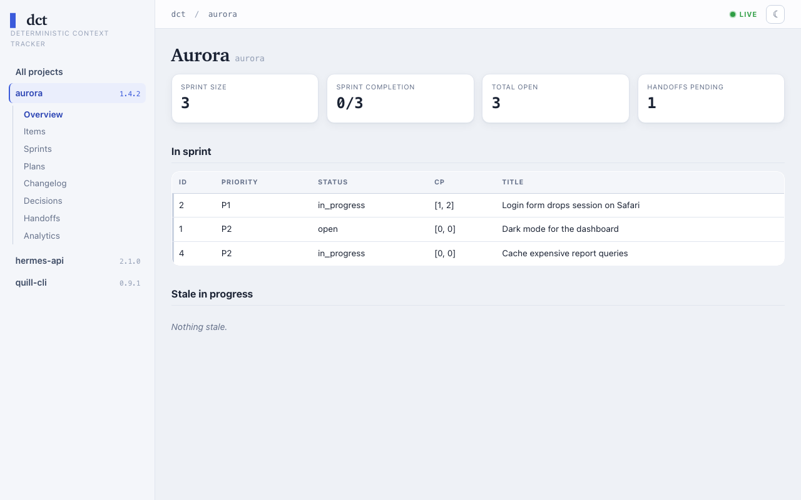

# dct — Deterministic Context Tracker

[](https://pypi.org/project/dctracker/)
[](https://www.python.org/downloads/)
[](https://github.com/fotodeveloper/dct/actions/workflows/ci.yml)
[](LICENSE)

Cross-project work tracking for [Claude Code](https://claude.com/claude-code). Track issues, todos, features, ideas, changelog entries, **plans, roadmaps, sprints, and decisions** across multiple projects in one database.

Part of the **dc tools** family ([dctools.dev](https://dctools.dev)) — *deterministic context* for AI-assisted development: your assistant reads facts from a database instead of guessing.

## Why dct?

You have a dozen side projects. Every Claude Code session starts cold — the assistant has no memory of what you decided last week, which bug you were mid-fix on, or why you picked SQLite over Postgres. So you re-explain, or it guesses.

The usual trackers don't fill the gap. GitHub Issues and Jira are per-repo, heavyweight, and live behind an API your assistant can't casually read or write. `TODO.md` files rot the moment you stop grooming them, and you can't query "every P1 across all my repos" from a pile of markdown.

dct is built for exactly this:

- **One user-scoped database** across all your projects — one place to ask "what's open everywhere?"
- **MCP-native** — the assistant reads and writes tracking directly, no copy-paste, no context loss.
- **Append-only ledger** — notes, checkpoints, and handoffs are soft-deleted, never dropped. Nothing is lost.
- **Session handoffs** — end a session with a handoff prompt; the next one picks up exactly where you left off.

## The session loop: `/handoff` → `/pickup`

The pair you will use most. AI coding sessions end; your context shouldn't.

**Ending a session — `/handoff`** flags the items you were working on as the
current sprint and stores a short prompt for whoever comes next (usually:
you, tomorrow). **Starting a session — `/pickup`** reads the newest unconsumed
handoff, shows the sprint with checkpoint progress, and proposes the first
action — so the session starts *in the middle of the work*, not from a cold
"what were we doing?". Illustrative session start:

```text
> /pickup
Handoff (2026-07-05, scope: sprint-15):
  "Theme tokens are merged; wire the toggle into settings next.
   The Safari session fix (#12) still awaits review."
Sprint: 3 items — #12 in_progress [2/4], #31 open, #7 open
Proposed first action: #12 — wire the theme toggle into settings.
```

Handoffs are database rows, not files: several can coexist per project
(`scope` tags disambiguate parallel workstreams), consuming one preserves it
in the ledger, and an unconsumed one can be amended in place. Surfaces:
`/handoff` and `/pickup` skills in Claude Code, `create_handoff` /
`list_handoffs` / `consume_handoff` / `update_handoff` over MCP,
`dct handoff update` in the CLI.

## Features

- **Centralized tracking** — one database for all your projects
- **Hybrid changelog** — entries in DB, export to Keep a Changelog markdown at release; **opt-in enforcement** + **per-project changelog location** (repo root by default, or a subdir like `pkg/changelog.md`)
- **Plans, specs, roadmaps, ADRs** — index markdown plans with stable ULID anchors; state in DB, content stays in markdown
- **First-class sprints** — named, lifecycle-tracked, with goal + item linkage
- **Decision records** — ADRs, sprint amendments, inline plan decisions with multi-anchor linkage
- **LLM-assisted classification** — uncertain plan sections auto-resolved via `claude --print` (haiku by default)
- **Passive autoscan hook** — PostToolUse hook re-scans plan-like files in background on every edit
- **MCP server** — native Claude Code integration via FastMCP, 48 tools
- **CLI** — fast `dct` command for hooks and scripts
- **Skills** — Claude Code slash commands (`/track`, `/clog`, `/dct-import`, `/plan-status`, …)
- **Soft deletes** — ledger pattern, nothing is ever lost
- **DB portable** — SQLite (zero setup) or PostgreSQL

## Installation

Pick one — whichever matches your Python workflow. The distribution is named **`dctracker`** (PyPI); the installed command is **`dct`**.

```bash
# Option A: uv tool (recommended — isolated, upgradable, editable for dev)
uv tool install dctracker --with 'mcp[cli]' --with 'psycopg[binary]'
# Or from source (dev):
uv tool install --editable /path/to/dct --with 'mcp[cli]' --with 'psycopg[binary]'

# Option B: pipx (classic isolated install)
pipx install 'dctracker[mcp,pg]'

# Option C: uvx (zero-install, fetches per-invocation)
# In ~/.claude.json:  { "command": "uvx", "args": ["--from", "dctracker[mcp,pg]", "dct", "server"] }

# Option D: pip into your venv (not recommended for global CLI)
pip install 'dctracker[mcp,pg]'
```

After installation `dct` must be in PATH. Verify:

```bash
dct --version    # -> dct <version>
dct server --help
dct plan --help  # plan subcommands
```

### First run

```bash
dct init
```

The interactive wizard walks through the one-time global bootstrap:

1. **Database backend** — `sqlite` (default, zero setup at `~/.claude/dct.db`) or `postgresql` (you supply the URL). It test-connects before saving.
2. **Register projects** — for each project it asks slug / path / name, then **auto-detects the version** from `VERSION`, `pyproject.toml`, `package.json`, `Cargo.toml`, or `src-tauri/tauri.conf.json`. If none matches, you get an interactive prompt (`0.0.1` / `0.1.0` / `1.0.0` shortcuts); in non-tty contexts it stores `current_version=NULL` and reminds you to set it later. Register more any time with `dct project add`.
3. **MCP server** — registered at **user scope** in `~/.claude.json` (via `claude mcp add --scope user`, with a direct-edit fallback), so `/track`, `/clog`, `/release`, and the MCP tools are available in **every** Claude Code session, from any directory.
4. **Skills + hooks** — symlinks the skills into `~/.claude/skills/` and the four hooks into `~/.claude/hooks/` (symlinks → the repo, so a repo fix goes live without reinstall).
5. **Hook wiring** — with your consent, merges the hooks into `~/.claude/settings.json`. The merge is idempotent, backs up the file before the first write, and never touches hooks you already have. Re-run any time with `dct hooks wire`.

`dct init` writes `~/.claude/dct.toml`, `~/.claude.json` (MCP entry), the skill/hook symlinks, and (opt-in) the settings.json wiring — see [docs/architecture.md](docs/architecture.md) for the full config reference and scope model.

### Troubleshooting

- **`dct: command not found` after install** — the install location isn't on your `PATH`. For `uv tool` / `pipx`, run their `ensurepath` helper (`uv tool update-shell` or `pipx ensurepath`) and restart the shell.
- **PostgreSQL connection fails at `dct init`** — either start your local Postgres and re-run, or just pick the **SQLite** default (the answer to the backend prompt) — it needs no server and works everywhere.
- **MCP tools don't show up in Claude Code** — the MCP server is a per-session subprocess, so newly registered tools (or a reinstall) appear only after you **restart the Claude Code session**. Start a fresh session and they'll be there.
- **Plans/decisions tools fail with `No module named 'ulid'`** — your installed tool environment predates the `python-ulid` dependency. Upgrade it: `uv tool upgrade dctracker` (or reinstall via your chosen option above).

## Usage

### CLI

```bash
# Items
dct add myproj todo "Fix parser crash" --priority P1 --tags "parser,crash"
dct list                              # All open items, all projects
dct list myproj --priority P1         # P1 items in myproj
dct show 42                           # Full item details with notes
dct update 42 --status in_progress
dct note 42 "Found root cause in tokenizer"
dct resolve 42 --resolution "Fixed in commit abc123"

# Changelog (project auto-detected from CWD; --project overrides)
dct clog add added "New Python parser support" --project myproj
dct clog list --project myproj --unreleased
dct clog count --project myproj       # Used by hooks
dct clog release 1.1 --project myproj # Stamp unreleased → 1.1
dct clog export --project myproj --output changelog.md

# Projects
dct project add myproj /path/to/myproj --name "My Project"    # Version auto-detected
dct project list
dct project detect                                            # Print current project slug (for hooks)
dct project rename myproj --slug myproj2 --name "Rebranded"   # Rename in-place, project_id stable
dct project set-version myproj 1.1                            # Post-factum version fix
dct project changelog myproj off                              # Opt out of dct changelog enforcement
dct project changelog-path myproj docs/changelog.md           # Changelog outside repo root; default: changelog.md

# Plans
dct plan rescan /path/to/docs/plans/2026-04-17-feature.md     # Idempotent rescan; hook entrypoint
dct plan rescan $FILE --quiet --resolve-uncertain             # Hook-mode flags

# Checkpoints (item-level)
dct checkpoint add 42 "Write parser"
dct checkpoint list 42
dct checkpoint done 3                 # Mark CP #3 as done
dct checkpoint reject 4               # Scope-change, keep in ledger
```

## MCP Tools

dct ships **48 MCP tools**, registered at user scope so they're callable from any Claude Code session as `mcp__dct__<name>`. Zero-arg calls auto-detect the project from the session's working directory; pass `project=<slug>` to override. The daily drivers:

| Tool | Purpose |
|---|---|
| `create_item` | Create a tracked item (issue / todo / feature / idea / improvement) |
| `list_items` | List / search items in compact `{cols, rows}` form |
| `update_item` | Update fields on an existing item |
| `resolve_item` | Close an item (terminal status), with gate-checkpoint guard |
| `add_checkpoint` | Add an acceptance criterion to an item |
| `complete_checkpoint` | Mark a checkpoint done (real-time, never batched) |
| `add_changelog` | Add an unreleased changelog entry |
| `release_changelog` | Stamp unreleased entries with a version + bump `current_version` |
| `set_sprint` | Atomically replace the current sprint's membership |
| `create_handoff` | Leave a handoff draft for the next session |

Full categorized catalogue of all 48 tools: **[docs/mcp-tools.md](docs/mcp-tools.md)**.

## Plans, Roadmaps & Decisions

dct extends the flat items model with **hierarchical plans**: markdown plan/spec/roadmap/ADR files stay the source of truth for content, while dct indexes their structure (sections, checkpoints, decisions) with stable **ULID anchors** and owns their state (done/pending/rejected). A PostToolUse hook rescans plan-like files in the background on every edit, injecting ULIDs and syncing the DB; uncertain section headings are classified by a headless `claude --print` call (haiku).

Full guide — concepts, ULID anchors, ingest pipeline, classification rules, and promotion to items/sprints: **[docs/plans.md](docs/plans.md)**.

## Web viewer

`dct web` runs a localhost-only, **read-only** browser dashboard over all registered projects (items, sprints, plans, changelog, decisions, handoffs, plus Radar / Backlog-Health / Velocity analytics) with live SSE refresh. It binds `127.0.0.1` only — no auth, single-user. Install the optional extra first:

```bash
pip install 'dct[web]'      # adds flask + markdown
dct web start               # start the daemon → prints http://localhost:8787
dct web start --open        # open the browser after starting
dct web status              # show pid + URL
dct web stop                # SIGTERM the daemon
```

If the preferred port (default `8787`) is busy, the daemon auto-selects the next free port (disable with `--no-fallback`). Configure defaults under `[web]` in `~/.claude/dct.toml`.



## Integration with Claude Code

dct is designed to be driven by Claude Code. To teach your assistant *when* to reach for each skill and MCP tool across every project, copy the ready-made snippet into your personal `~/.claude/CLAUDE.md`: **[docs/CLAUDE.md-snippet.md](docs/CLAUDE.md-snippet.md)**.

### Skills

| Skill | Purpose |
|---|---|
| `/track` | Create a tracked item |
| `/track-list` | List/search items |
| `/track-update` | Update item fields |
| `/track-resolve` | Resolve/close items |
| `/clog` | Add changelog entry |
| `/commit` | Conventional commit with version suffix + changelog gate |
| `/release` | Stamp changelog + bump version + generate `changelog.md` |
| `/pickup` | Session start — read handoff, show sprint, propose first action |
| `/handoff` | Session end — flag sprint items, write handoff prompt |
| `/dct-import` | Discover + multi-select + ingest plan-like markdown files |
| `/dct-init` | Bootstrap dct + register the current project (interactive) |
| `/plan-status` | Cross-plan progress dashboard |
| `/plan-resolve-uncertain` | Batch classify uncertain plan sections via haiku |

## Global Hooks

`dct init` **symlinks** four hooks into `~/.claude/hooks/` (→ the repo `hooks/`, so a repo fix is live without reinstall) and — with your consent — **wires them into `~/.claude/settings.json` automatically**. The wiring is an idempotent merge: hooks you already have (dct or your own, in any placement) are never touched, and the file is backed up before the first write. Re-run any time:

```bash
dct hooks wire            # idempotent; safe after upgrades or manual edits
```

| Hook | Event | Purpose |
|---|---|---|
| `dct-check-changelog.sh` | PreToolUse (`Bash`) | blocks `git commit` when app code changed but no unreleased changelog entry exists — opt-in per project via `dct project changelog <slug> on\|off` |
| `dct-check-changelog-on-stop.sh` | Stop | session-end reminder about pending unreleased entries (same opt-in gate) |
| `dct-plan-autoscan.sh` | PostToolUse (`Edit\|Write\|MultiEdit`) | background rescan of plan-like MD files; fire-and-forget |
| `dct-task-mirror.sh` | PreToolUse (`TodoWrite\|TaskCreate`) | mirrors Claude Code tasks into dct as `cc-task` checkpoints |

Manual wiring reference (full JSON) and the five rules every dct hook follows: [docs/hooks.md](docs/hooks.md).

## Configuration

dct reads `~/.claude/dct.toml`. The minimal config is just the database URL:

```toml
[database]
url = "sqlite:////Users/you/.claude/dct.db"
# or: url = "postgresql+psycopg://localhost:5432/dct"
```

The `DCT_DATABASE_URL` environment variable overrides `[database].url`. For the full reference (`[plans]`, `[mirror]`, `[web]` sections), the database schema, MCP scope precedence, and project auto-detection mechanics, see **[docs/architecture.md](docs/architecture.md)**.

## Testing

```bash
.venv/bin/pytest -q                    # All tests (670)
.venv/bin/pytest tests/test_plan_parser.py -v          # Parser only
.venv/bin/pytest tests/test_plan_ingest.py -v          # Ingest + sticky-resolved semantics

# MCP server smoke (boot + tool list)
uv run --no-project --with 'mcp[cli]' --with sqlalchemy --with 'psycopg[binary]' \
  python -c "import asyncio; from dct.server import mcp; \
  print(len(asyncio.run(mcp.list_tools())), 'tools')"
```

## License

MIT — see [LICENSE](LICENSE).
